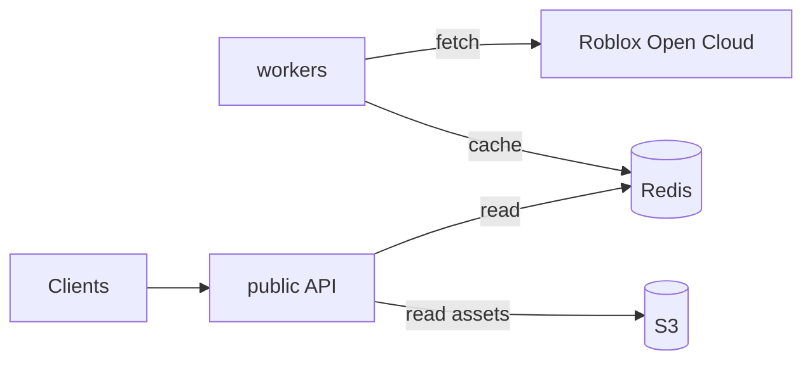

# Public Experience API
The official, publcily accessible API for data fetching from Typical Developers' Roblox experiences.

## Development
### Prerequisites
- Go 1.26.0
- Redis
- An S3-compatible bucket

### Configuration
All services read a single `.env` file at the repo root. Copy `.env.example` to `.env` and fill it in.
| Variable | Required | Default | Description |
| --- | --- | --- | --- |
| `ENVIRONMENT` | | `production` | `production` or `development`. Development points at the staging experience. |
| `LOG_LEVEL` | | `info` / `debug` | Defaults to `debug` in development, `info` otherwise |
| `OPENCLOUD_KEY` | ✅ | | Roblox Open Cloud API key |
| `ASSET_BASE_URL` | | `http://localhost:8080` | Base URL used to build media URLs in responses (API host or CDN) |
| `LOG_WEBHOOK_URL` | | | Webhook for error and panic logging |
| `OAKLANDS_ALWAYS_EXECUTE_IN_LATEST` | | `false` | _TODO: describe_ |
| `S3_ENDPOINT` | ✅ | | S3-compatible endpoint |
| `S3_REGION` | | | Bucket region |
| `S3_BUCKET` | ✅ | | Bucket name |
| `S3_ACCESS_KEY` | ✅ | | Access key |
| `S3_SECRET_ACCESS_KEY` | ✅ | | Secret key |
| `REDIS_HOST` | | `localhost` | Redis host |
| `REDIS_PORT` | | `6379` | Redis port |
| `REDIS_PASSWORD` | | | Redis password |
| `REDIS_DB` | | `0` | Redis database index |

### Running with Docker Compose
Docker Compose is used to test and deploy.
```sh
docker compose up --build
```

### Generating `scalar` Docs
The API reference is generated from handler annotations with [swag](https://github.com/swaggo/swag).
```sh
go install github.com/swaggo/swag/cmd/swag@v1.16.6
swag init -g cmd/public/main.go -o docs
```

## Architecture
This project consists of two different services to sync and expose experience data. A Redis instance is hosted to store data received from workers, which is then read and served by the API. [`scalarapi`](https://scalar.com/) is used to host documentation for the API.
| Service   | Role                                                                             |
| --------- | -------------------------------------------------------------------------------- |
| `public`  | The HTTP API, exposed on port 8080.                                              |
| `workers` | Jobs that sync experience data, utilizing Roblox's OpenCloud LuauExecution APIs. |

